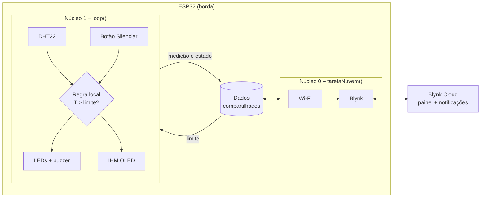
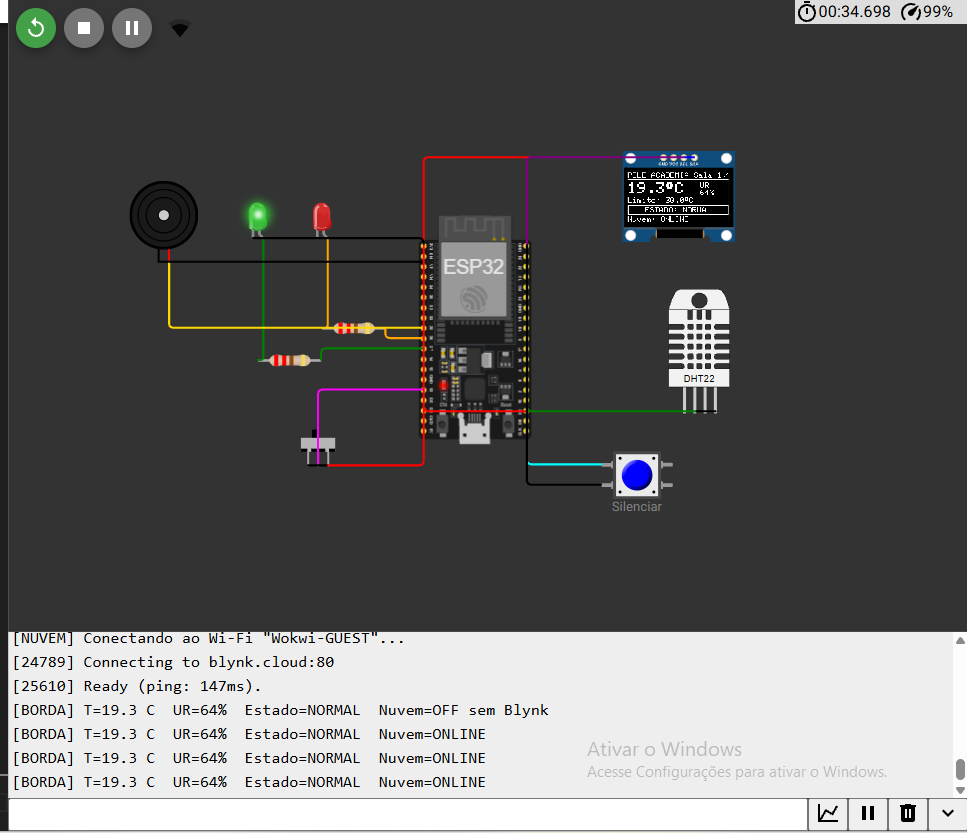
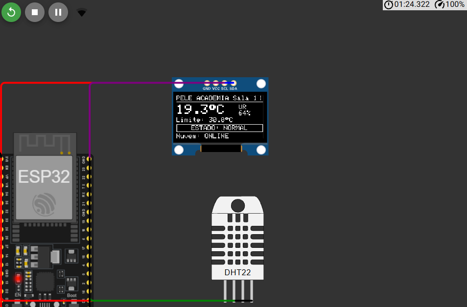
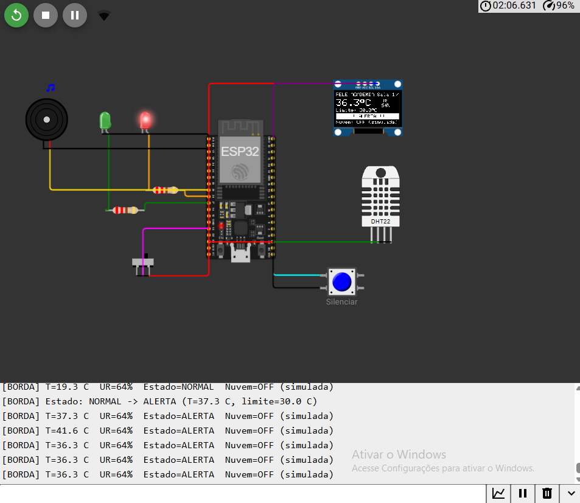
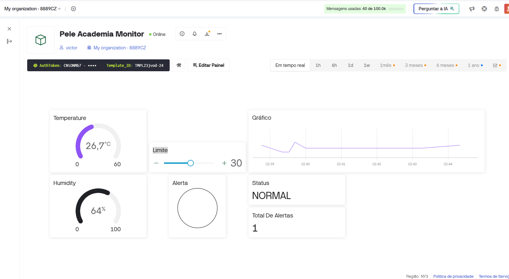

# Monitor Ambiental – Pelé Academia

Protótipo de **Edge Computing** com ESP32 para monitorar a temperatura de um espaço de treino
da Pelé Academia. O ESP32 lê o sensor, decide sozinho quando há risco, aciona LED e buzzer,
mostra tudo em um display OLED e envia os dados ao **Blynk** para acompanhamento remoto.
Se a nuvem cair, a borda continua funcionando normalmente.

## Integrantes

| Nome | RM |
|---|---|
| Arthur Bergami Lucas | 570679 |
| Davi Martins Herculano | 572699 |
| Felipe Braga Terzella | 573529 |
| Marcos Vinícios Corrêa dos Santos | 571080 |
| Victor Lopes Tavares da Fonseca | 571315 |

## Links da entrega

| Item | Link |
|---|---|
| Repositório (código-fonte do ESP32) | https://github.com/khrokihh45lopes/pele-academia-monitor-edge |
| Projeto no Wokwi | https://wokwi.com/projects/479102198742488065 |
| Painel no Blynk | Requer login na conta – veja a [captura do painel](#capturas-de-tela) |

---

## Visão geral

| | |
|---|---|
| Variável monitorada | Temperatura do ambiente (°C), com umidade relativa como informação complementar |
| Sensor | DHT22 |
| Valor de referência | **30,0 °C** (ajustável pelo Blynk, salvo na flash do ESP32) |
| Atuadores | LED vermelho (alerta), LED verde (normal), buzzer |
| IHM local | Display OLED SSD1306 128×64 + botão "Silenciar" |
| Nuvem | Blynk IoT (painel web/app e notificações) |
| Simulação | Wokwi |

## Arquitetura

O firmware usa os dois núcleos do ESP32 para separar a borda da comunicação:



- **`loop()` (núcleo 1)** – lê o sensor a cada 2,5 s, aplica a regra, aciona LEDs/buzzer e
  redesenha a IHM a cada 250 ms. Não chama nenhuma função de rede, por isso nunca fica
  esperando a nuvem.
- **`tarefaNuvem()` (núcleo 0)** – conecta e reconecta Wi-Fi e Blynk, envia os dados e recebe
  o novo limite. Timeouts e tentativas de reconexão travam só esta tarefa.
- Os dois lados trocam dados por uma área compartilhada protegida por seção crítica
  (`portENTER_CRITICAL`).

## O que roda na borda e o que depende da nuvem

| Operação | Onde | Funciona sem nuvem? |
|---|---|---|
| Leitura periódica do DHT22 | **Borda** (ESP32) | Sim |
| Validação da leitura e detecção de falha do sensor | **Borda** | Sim |
| Regra de decisão (temperatura > limite, com histerese de 0,5 °C) | **Borda** | Sim |
| Acionamento do LED vermelho/verde e do buzzer | **Borda** | Sim |
| IHM no OLED (valor, estado, limite, status da nuvem) | **Borda** | Sim |
| Botão local para silenciar o buzzer | **Borda** | Sim |
| Guarda do limite na flash (NVS) | **Borda** | Sim – usa o último valor recebido |
| Filtro de envio (só manda ao Blynk o que mudou) | **Borda** | – |
| Contagem de alertas ocorridos durante a queda | **Borda** | Sim – são avisados ao reconectar |
| Painel remoto (temperatura, umidade, estado, alertas) | **Nuvem** (Blynk) | Não – volta a atualizar ao reconectar |
| Histórico/gráfico de temperatura | **Nuvem** | Não |
| Ajuste remoto do limite (slider) | **Nuvem** → borda | Não – a borda mantém o último limite |
| Notificação de alerta (evento `alerta_temperatura`) | **Nuvem** | Não – enviada quando a conexão volta |

Em resumo: **toda a decisão acontece no ESP32**. O Blynk só observa e configura; ele nunca
precisa responder para que o alerta seja acionado.

## Regra de decisão

| Estado | Condição | LED verde | LED vermelho | Buzzer | IHM |
|---|---|---|---|---|---|
| NORMAL | T ≤ limite (saindo de um alerta: T ≤ limite − 0,5 °C) | aceso | apagado | desligado | `ESTADO: NORMAL` |
| ALERTA | T > limite | apagado | aceso | bipa 200 ms a cada 1 s | `!! ALERTA !!` em faixa invertida |
| ALERTA silenciado | ALERTA + botão pressionado | apagado | aceso | desligado | `ALERTA - SILENCIADO` |
| FALHA NO SENSOR | 3 leituras inválidas seguidas | apagado | piscando | desligado | `FALHA NO SENSOR` |

A histerese evita que o alerta fique ligando e desligando quando a temperatura oscila em cima
do limite. O silêncio vale só para o alerta atual: um novo alerta volta a soar.

## Circuito

| Componente | Pino do componente | ESP32 |
|---|---|---|
| DHT22 | SDA (dados) | GPIO 15 |
| OLED SSD1306 (I²C, 0x3C) | SDA / SCL | GPIO 21 / GPIO 22 |
| LED vermelho + resistor 220 Ω | anodo | GPIO 26 |
| LED verde + resistor 220 Ω | anodo | GPIO 27 |
| Buzzer | + | GPIO 25 |
| Botão "Silenciar" | um contato (o outro no GND) | GPIO 4 (pull-up interno) |
| Chave deslizante "falha da nuvem" | pino central (laterais no GND e 3V3) | GPIO 13 |

Todos os componentes são alimentados em 3,3 V. Em hardware real, use um resistor de 10 kΩ de
pull-up na linha de dados do DHT22 (os módulos prontos já vêm com ele).

## IHM local (OLED)

```
┌────────────────────────────┐
│PELE ACADEMIA Sala 1       /│  ← indicador girando: prova que a borda está rodando
│────────────────────────────│
│28.4°C              UR      │
│                    55%     │
│Limite: 30.0°C              │
│┌──────────────────────────┐│
││      ESTADO: NORMAL      ││  ← faixa invertida quando em ALERTA
│└──────────────────────────┘│
│Nuvem: ONLINE               │  ← ONLINE / OFF sem WiFi / OFF sem Blynk / OFF (simulada)
└────────────────────────────┘
```

## Painel Blynk

| Pino virtual | Dado | Widget |
|---|---|---|
| V0 | Temperatura (°C) | Gauge + Chart |
| V1 | Umidade (%) | Gauge ou Label |
| V2 | Alerta (0/1) | LED |
| V3 | Status em texto | Label |
| V4 | Limite (°C) – app → ESP32 | Slider |
| V5 | Total de alertas | Label |

O passo a passo completo (template, datastreams, evento e painel) está em
[docs/blynk-setup.md](docs/blynk-setup.md).

Para economizar mensagens, a borda só envia um valor quando ele muda (0,1 °C para
temperatura, 1 % para umidade, qualquer mudança de estado) e faz um reenvio completo a cada
60 s e logo após cada reconexão.

## Como executar no Wokwi

1. Acesse [wokwi.com](https://wokwi.com) e crie um projeto novo com **ESP32**.
2. Substitua o conteúdo de `sketch.ino` e `diagram.json` pelos arquivos da pasta
   [`firmware/`](firmware/).
3. Crie um arquivo `libraries.txt` (botão **+** ao lado das abas) com o conteúdo de
   [`firmware/libraries.txt`](firmware/libraries.txt).
4. Configure o Blynk ([docs/blynk-setup.md](docs/blynk-setup.md)) e cole o `BLYNK_TEMPLATE_ID`,
   o `BLYNK_TEMPLATE_NAME` e o `BLYNK_AUTH_TOKEN` no topo do `sketch.ino`.
5. Clique em **▶ Start**. O ESP32 se conecta à rede `Wokwi-GUEST` e ao Blynk; acompanhe pelo
   monitor serial.
6. Clique no DHT22 e mova o controle de temperatura acima de 30 °C para gerar um alerta.
7. Salve o projeto (**Save**) e copie o link para a seção [Links da entrega](#links-da-entrega).

Sem credenciais válidas do Blynk o protótipo funciona do mesmo jeito: a IHM mostra
`Nuvem: OFF sem Blynk` e a borda segue decidindo normalmente.

## Roteiro de teste: nuvem indisponível

A chave deslizante ligada ao GPIO 13 simula a queda da comunicação. Na posição da **direita**
o ESP32 desliga o Wi-Fi e o Blynk; na da **esquerda** (padrão) volta a conectar.

| # | Ação | Resultado esperado |
|---|---|---|
| 1 | Iniciar a simulação com a chave à esquerda | IHM: `Nuvem: ONLINE`; painel Blynk recebe temperatura e status |
| 2 | Mover a chave para a direita | IHM: `Nuvem: OFF (simulada)`; dispositivo aparece *offline* no Blynk |
| 3 | Com a nuvem fora, subir a temperatura do DHT22 para 35 °C | Em até 2,5 s: LED vermelho aceso, buzzer bipando, IHM `!! ALERTA !!` – sem nenhuma resposta da nuvem |
| 4 | Pressionar o botão **Silenciar** | Buzzer para; IHM `ALERTA - SILENCIADO`; LED vermelho continua aceso |
| 5 | Baixar a temperatura para 25 °C | Volta para NORMAL (LED verde) |
| 6 | Mover a chave de volta para a esquerda | Reconecta em poucos segundos; painel recebe o estado atual, o total de alertas e a notificação do alerta que aconteceu offline |

Durante os passos 2 a 5 o indicador girando no canto da IHM e o monitor serial
(`[BORDA] T=... Estado=... Nuvem=OFF (simulada)`) mostram que leitura, IHM e decisão local
continuaram rodando.

## Capturas de tela

| Circuito no Wokwi | IHM – estado normal |
|---|---|
|  |  |

| IHM – alerta com a nuvem fora do ar | Painel Blynk após reconectar (alerta ocorrido offline contabilizado) |
|---|---|
|  |  |

> O protótipo foi desenvolvido e testado em simulação no Wokwi, sem montagem física. Por isso
> não há fotografia: o circuito está representado pela captura do Wokwi acima.

## Critérios de avaliação

| Critério | Onde é atendido |
|---|---|
| Conectar um sensor ao ESP32 | DHT22 no GPIO 15 – [`diagram.json`](firmware/diagram.json) |
| Leitura periódica | `lerSensor()` a cada 2,5 s no `loop()` |
| Valor de referência para alerta | `LIMITE_PADRAO = 30.0` °C, ajustável pelo V4 |
| Decisão diretamente no ESP32 | `avaliarRegra()` – não depende da nuvem |
| Acionar LED/buzzer | `acionarSaidas()` – LEDs nos GPIO 26/27, buzzer no GPIO 25 |
| Valor e estado em IHM local | `desenharIHM()` – OLED SSD1306 |
| Integração com Blynk | `tarefaNuvem()` e `sincronizarPainel()` |
| Painel com valor e estado | V0–V5 – [docs/blynk-setup.md](docs/blynk-setup.md) |
| Desenvolvido e testado no Wokwi | [`firmware/`](firmware/) + link do projeto |
| Código no GitHub | este repositório |
| Funcionamento sem a nuvem | chave no GPIO 13 + [roteiro de teste](#roteiro-de-teste-nuvem-indisponível) |
| Acompanhamento remoto pelo Blynk | painel web/app + evento `alerta_temperatura` |

## Estrutura do repositório

```
.
├── README.md              ← este documento (entrega)
├── integrantes.txt        ← nomes e RMs do grupo
├── firmware/
│   ├── sketch.ino         ← código-fonte do ESP32
│   ├── diagram.json       ← circuito do Wokwi
│   └── libraries.txt      ← bibliotecas usadas no Wokwi
└── docs/
    ├── blynk-setup.md     ← configuração do template e do painel Blynk
    └── img/               ← capturas de tela da IHM, do Wokwi e do Blynk
```
